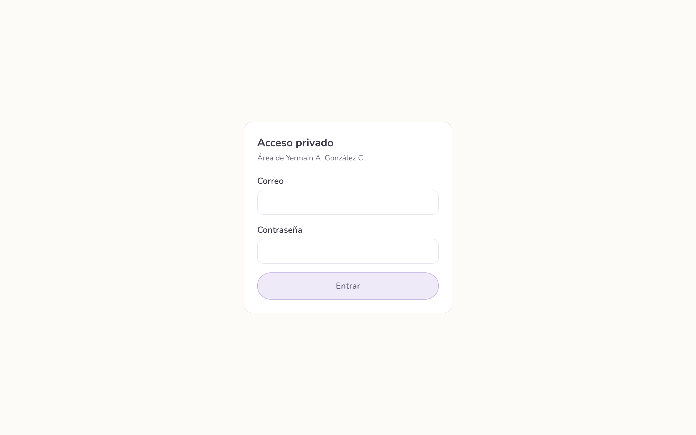

# psico.yerma

[](https://github.com/OswaldoRodriguez123/psico-yerma/actions/workflows/ci.yml)

Website for a child and teen psychology practice, with a private admin panel to
manage inquiries and clients.

[Live site](https://psico-yerma.vercel.app)


## Features

**Public site**

- Home, About, Services, FAQ and Contact, in Spanish, responsive and
  SEO-ready (metadata, sitemap, robots, Open Graph image).
- Contact form with server-side Zod validation, Cloudflare Turnstile spam
  protection, storage in Supabase and an email notification through Resend.
- A private, unlinked letter page (`/carta`) that is excluded from the sitemap
  and search engines.

**Admin panel** (`/admin`, protected by `src/proxy.ts`)

- Email/password login with Supabase Auth; every `/admin` route redirects to
  `/login` when there is no session.
- Dashboard with contact stats (by status and by reason) and the latest
  inquiries.
- Contacts table with status changes (`new`, `contacted`, `closed`).
- Clients CRUD with its own form, validation and tests.



## Stack

- Next.js 16 (App Router) + React 19 + TypeScript
- Tailwind CSS v4
- Supabase (Postgres + Auth) with `@supabase/ssr`
- Resend for email notifications
- Zod for validation
- TanStack Table and Recharts in the admin panel
- Vitest for tests

## Getting started

Requires Node.js 20.9+.

```bash
npm install
cp .env.example .env.local   # fill in the values
npm run dev
```

Open http://localhost:3000.

## Environment variables

```text
SUPABASE_URL=
SUPABASE_ANON_KEY=
SUPABASE_SERVICE_ROLE_KEY=
RESEND_API_KEY=
CONTACT_FROM_EMAIL=onboarding@resend.dev
CONTACT_TO_EMAIL=
TURNSTILE_SITE_KEY=
TURNSTILE_SECRET_KEY=
```

- `SUPABASE_SERVICE_ROLE_KEY` is secret and only used on the server (never with
  a `NEXT_PUBLIC_` prefix).
- Database: run `supabase/migrations/0001_create_contacts.sql` and
  `0002_create_clients.sql` in the Supabase SQL Editor.

## Scripts

| Command | Description |
| --- | --- |
| `npm run dev` | Development server |
| `npm run build` | Production build |
| `npm run start` | Serve the build |
| `npm run lint` | ESLint |
| `npm run typecheck` | Type check |
| `npm test` | Tests (Vitest) |

## Structure

```text
src/
├── app/                 # routes (App Router), admin, login and API handlers
├── components/          # shared UI (layout/ and ui/)
├── features/contact/    # contact feature (schema, server, form, table)
├── features/clients/    # clients feature (schema, server, form, table)
├── lib/                 # shared infrastructure (Supabase clients)
├── content/site.ts      # all site copy
└── proxy.ts             # auth guard for /admin
```

## Tests

```bash
npm test
```

Vitest covers contact validation, the contact API route, Turnstile
verification, the notification template, and client create/update/delete.

## Deploy

Deployed on Vercel with Supabase as the database. Set the environment variables
in the host. A daily cron hits `/api/keepalive` so the free Supabase project does
not pause after inactivity.

## License

MIT for the code. See [LICENSE](LICENSE). The brand, copy and images belong to
the client and are not covered by the MIT license.
